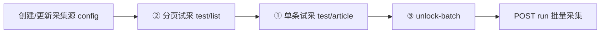

# AMI 采集源试采与批量上线

在 **AMI API 已运行**（默认 `http://127.0.0.1:8080`）时，按固定顺序完成：配置 → 分页试采 → 单条试采（质检）→ 解锁批量 → 批量运行。

开发服务重启见 [.cursor/skills/ami-restart-dev/SKILL.md](../ami-restart-dev/SKILL.md)。

## 流程总览



| 步骤 | API | 通过条件 |
|------|-----|----------|
| 配置 | `POST/PATCH /api/v1/settings/collect-sources` | `list_url`、抽链规则、`pagination` 正确 |
| ② 分页试采 | `POST .../test/list` | `passed=true` 且 `linkCount>0` |
| ① 单条试采 | `POST .../test/article` | `passed=true`（流水线 + 质检） |
| ③ 解锁 | `POST .../unlock-batch` | 前两步时间戳已写入 |
| 批量 | `POST .../run` | `batchUnlocked=true` |

编辑 config 会 **重置** 试采状态，需重新走 ②→①→③。

## 分页类型怎么选

| 站点行为 | `pagination.type` | 说明 |
|----------|-------------------|------|
| 静态 HTML 列表 + `/page/2/` | `path` | `path_template` 含 `{page}`，`start_page` 通常为 2 |
| WordPress「加载更多」、列表页无文章链接 | `wordpress_ajax` | 从列表页解析 `blog_loadmore_params`，POST `admin-ajax.php` |
| RSS/Atom | 源类型用 `rss` | `feed_url`，无需 list 试采 |
| 仅详情 URL | `direct_url` | 无需 list 试采 |

**Unit42 标签页**（如 `https://unit42.paloaltonetworks.com/tag/botnet/`）必须用 `wordpress_ajax`，不要用 `path`：列表文章由 AJAX 注入，路径分页 HTML 中无文章链接。

实现：`service/internal/ingest/wordpress_ajax.go`。

## Unit42 botnet 参考配置

```json
{
  "list_url": "https://unit42.paloaltonetworks.com/tag/botnet/",
  "article_base": "https://unit42.paloaltonetworks.com",
  "link_extract": {
    "must_contain": "unit42.paloaltonetworks.com",
    "exclude_contains": [
      "/tag/", "/page/", "/feed/", "/category/", "/wp-",
      "/tools/", "/atoms/", "/about-unit", "/unit-42-threat", "/ja/"
    ]
  },
  "pagination": {
    "type": "wordpress_ajax",
    "max_pages": 5,
    "stop_on_empty_list": true
  },
  "max_items_per_run": 50,
  "delay_ms": 1500,
  "timeout_sec": 45
}
```

源类型：`paginated_list`（或 `scheduled_url`，二者均需 list 试采）。

## 一键脚本（已验证）

```bash
# 需 API 监听 8080，且为含 wordpress_ajax 的后端构建
bash scripts/collect-pilot-unit42-botnet.sh
```

环境变量：`AMI_API`、`SOURCE_NAME`。

成功标志：脚本 exit 0；`test/list` 的 `linkCount>0`；`test/article` 的 `passed=true`；`run` 返回 `imported`/`skipped`。

## 通用 API 示例（新源）

```bash
API=http://127.0.0.1:8080/api/v1

# 1. 创建
ID=$(curl -sf -X POST "$API/settings/collect-sources" \
  -H 'Content-Type: application/json' \
  -d '{"name":"My Source","type":"paginated_list","sourceLabel":"vendor","config":{...}}' \
  | python3 -c "import json,sys; print(json.load(sys.stdin)['id'])")

# 2. 分页试采（可选 maxPages）
curl -sf -X POST "$API/settings/collect-sources/$ID/test/list" \
  -H 'Content-Type: application/json' -d '{"maxPages":3}'

# 3. 单条试采（用 sampleUrls[0]）
curl -sf -X POST "$API/settings/collect-sources/$ID/test/article" \
  -H 'Content-Type: application/json' \
  -d '{"url":"https://example.com/article/","waitPipeline":true}'

# 4. 解锁 + 批量
curl -sf -X POST "$API/settings/collect-sources/$ID/unlock-batch" -d '{}'
curl -sf -X POST "$API/settings/collect-sources/$ID/run" -d '{}'
```

## 排错

| 现象 | 处理 |
|------|------|
| `test/list` linkCount=0 | 检查分页类型；Unit42 改为 `wordpress_ajax` |
| `unlock-batch` 400 | 单条试采未通过或未执行；看 `checks` |
| `run` 400 未解锁 | 先 `unlock-batch` |
| 单条 `remote_img` 失败 | 确认流水线 `succeeded`；大量配图已落盘时质检会放行（见 `quality_gate.go`） |
| 配置 PATCH 后批量被挡 | 重新 ②→①→③（仅 list/抽链/分页规则变更会重置；改 `max_items_per_run` 不会） |
| 再次运行 imported=0、skipped 很多 | 正常：已入库 URL 会跳过；修复后会在跳过基础上继续采分页后续链接 |
| 总量少于预期 | 提高 `max_items_per_run`；确认 `pagination.max_pages` 覆盖站点 `max_page` |

WebUI：**设置 → 采集源 → 上线前测试**（与 API 等价）。

## 相关代码

| 模块 | 路径 |
|------|------|
| 试采 API | `service/internal/api/collect_pilot.go` |
| 质检 | `service/internal/pipeline/quality_gate.go` |
| 路径分页 | `service/internal/ingest/pagination.go` |
| WP AJAX | `service/internal/ingest/wordpress_ajax.go` |
| 前端试采 | `webui/src/views/settings/SettingsCollectPage.vue` |

更多配置字段见 [reference.md](reference.md)。
