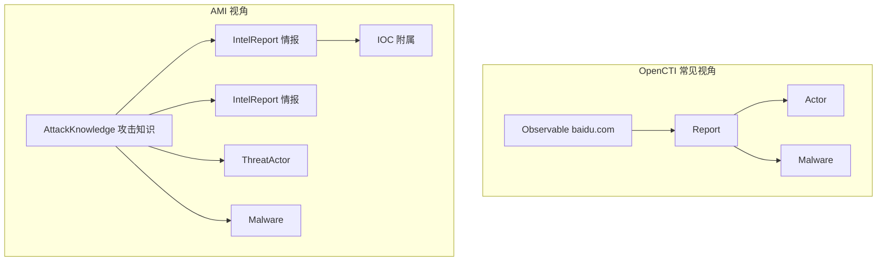
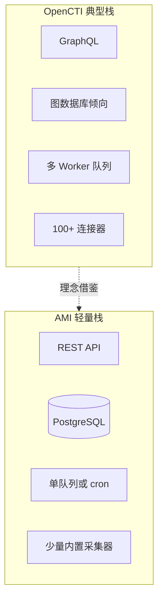
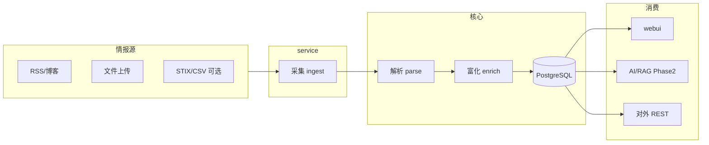
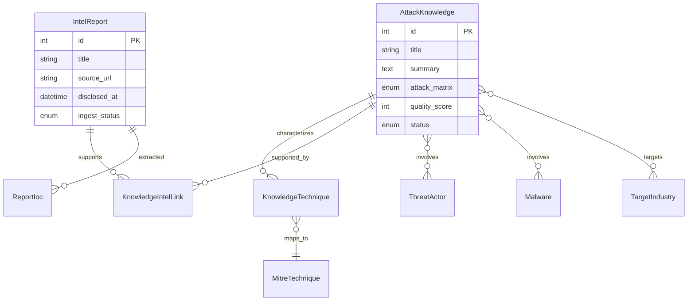
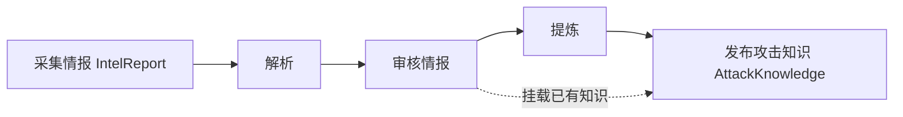
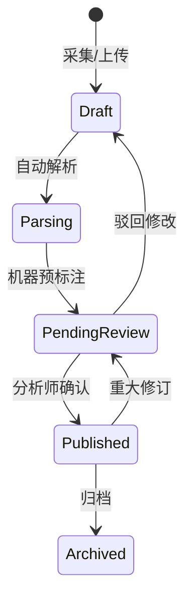

# AMI 攻击知识情报平台 — 总体设计（轻量版）

> 参考 [OpenCTI](https://docs.opencti.io/latest/usage/data-model/) 的知识图谱与 STIX 2.1 思路，裁剪为企业可落地的轻量情报库；**不含**控制措施映射、多租户、重型图谱引擎。

---

## 1. 设计目标

| 目标 | 说明 |
|------|------|
| **知识结构化** | 将报告/告警类非结构化内容转为可检索、可关联的实体与关系 |
| **TTP 标准化** | 攻击手法对齐 MITRE ATT&CK（Enterprise / ICS，由攻击行业驱动） |
| **溯源可证** | 每条结论可回溯到来源报告与原文片段 |
| **AI 就绪** | 结构化事实库 + 原文分块，供后续 RAG/研判使用 |
| **轻量可运维** | 单体或少量服务、PostgreSQL 为主、避免 OpenCTI 级组件栈 |

---

## 2. 与 OpenCTI 的根本差异：检索中心不同

| 维度 | OpenCTI（威胁情报平台） | AMI（攻击知识库） |
|------|-------------------------|-------------------|
| **核心对象** | 图谱中的 **实体 / 可观测对象**（域名、IP、哈希、恶意软件…） | **攻击知识（AttackKnowledge）**：TTP、手法、活动认知、行业语境下的攻击行为 |
| **典型入口** | 搜 `baidu.com` → 看所有 Report、Actor、Malware 关联 | 搜 **T1190 / Mirai 工控手法 / 某 APT 活动** → 看沉淀的攻击知识 → 再下钻情报与实体 |
| **Report 角色** | 串联图谱的 **枢纽**（几乎一切挂在 Report 上） | **情报（IntelReport）** 是 **证据层**，挂在攻击知识 **下面**，回答「这条知识依据哪几份报告」 |
| **IOC 地位** | 一等公民，运营常从 Indicator 切入 | **附属证据**，从属于情报或攻击知识，**不是**产品首页中心 |
| **用户问题** | 「这个域名/IOC 出现过哪些上下文？」 | 「这类攻击是什么手法、打谁、依据是什么、和已知 APT 有何关系？」 |



**结论：** AMI 借鉴 OpenCTI 的 STIX 实体类型与关系 **词汇**，但 **不复制其「以可观测对象为圆心」的产品结构**；内核是 **攻击知识库**，情报与实体是挂载与支撑材料。

---

## 3. 与 OpenCTI 对照：采纳与裁剪

OpenCTI 实现：**STIX 2.1 知识图谱** + **连接器** + **GraphQL** + 图谱 UI。

| OpenCTI 能力 | AMI 轻量策略 |
|--------------|--------------|
| STIX SDO | **采纳子集**，但归属 **AttackKnowledge**：ThreatActor、Malware、Attack Pattern（Technique）、Campaign；**Report → 降为 IntelReport（情报）** |
| STIX SCO（IP、域名、哈希…） | **采纳**：IOC 表，类型简化枚举 |
| SRO 关系（uses、targets、indicates、related-to…） | **采纳核心关系**：`report-mentions`、`uses`、`targets-industry`、`attributed-to`、`indicates`；不做全量 STIX 关系 |
| 知识图谱 UI / 图数据库 | **Phase 3 可选**：首期用关系表 + 列表/详情跳转，不强制 Neo4j |
| 连接器框架（Python、STIX Bundle 队列） | **轻量连接器**：HTTP 拉取 / RSS / 文件上传 → 归一化 JSON → 入库队列；STIX 导入/export 作 **可选格式** 非内核 |
| GraphQL | **REST + OpenAPI**（更简单、与 demo 一致） |
| 置信度、first/last seen、来源引用 | **采纳**：confidence、disclosed_at、source_ref、证据片段 |
| 工作区/多组织、RBAC 细粒度 | **单企业** RBAC（分析师/管理员） |
| 控制措施 / 缓解映射 | **不做**（已确认范围外） |
| MISP/TheHive 深度集成 | **Phase 3 可选 API**，不做内置复制 |



---

## 4. 总体架构



| 组件 | 职责 |
|------|------|
| **ingest** | 拉取、去重、原始物证存储（对象存储或 DB blob） |
| **parse** | HTML/PDF → 正文、章节、候选实体 |
| **enrich** | 从情报 **提炼** 攻击知识候选；行业/TTP/IOC 推荐 |
| **kb** | 攻击知识（核心）、情报、实体、关系 |
| **webui** | 攻击知识库首页；情报工作台；实体索引（二级） |
| **ai**（后期） | 分块索引、引用式问答 |

**部署（轻量）：** 1 个 API 进程 + 1 个 Worker（或 cron 任务）+ PostgreSQL；向量库（pgvector / 独立 Qdrant）Phase 2 再加。

---

## 5. 知识模型：以「攻击知识」为核心

### 5.1 两层对象

| 层级 | 对象 | 含义 | 类比 |
|------|------|------|------|
| **核心层** | `AttackKnowledge`（攻击知识） | 经提炼、可复用的攻击认知：手法、TTP、目标行业、主体、概述 | 知识库里的「一条知识」 |
| **证据层** | `IntelReport`（情报） | 采集的一则报告/博客/告警原文及解析结果 | OpenCTI 的 Report，但在 AMI 中 **从属于** 攻击知识 |
| **引用层** | `ThreatActor`、`Malware` 等 **实体** | 攻击参与方、工具家族，被攻击知识 **引用** | 非首页检索中心 |
| **附属层** | `Ioc` | 从情报中抽取的指标，作佐证 | 不等同于 OpenCTI 首页搜域名 |

关系要点：

- **多份情报 → 一条攻击知识**（`supports`）：多篇报告描述同一活动/手法时合并沉淀。
- **一条攻击知识 → 多个实体**（`involves`）：APT、恶意软件家族。
- **情报 → IOC**（`extracted_from`）：IOC 主要挂在情报上；攻击知识可通过情报间接引用 IOC。



### 5.2 与当前 Demo 的对应关系

| Demo 现状 | 目标模型 | 说明 |
|-----------|----------|------|
| 列表行 `IntelEntry` | 现阶段视同为 **IntelReport（情报）** | 便于采集与审核工作流 |
| 详情中的 TTP/行业/概述 | 应逐步归属 **AttackKnowledge** | Phase 2 拆表；可先 1 情报 : 1 知识 |
| 列表名「事件知识库」 | 产品名保留，语义为 **攻击知识库** | UI 文案可改为「攻击知识」列表（Phase 2） |

### 5.3 实体（轻量 STIX 对齐）

详见 [data-model.md](./data-model.md)。摘要：

| AMI 实体 | STIX 2.1 参考 | 说明 |
|----------|---------------|------|
| `AttackKnowledge` | （无直接 SDO，近似多个 SDO 的聚合视图） | **核心**，含 TTP、行业、概述 |
| `IntelReport` | Report | 情报/报告，**证据** |
| `ThreatActor` | Threat Actor / Intrusion Set | 被攻击知识 **involves** |
| `Malware` | Malware | 被攻击知识 **involves** |
| `Campaign` | Campaign | 可选，攻击活动 |
| `MitreTechnique` | Attack Pattern | Technique 引用 |
| `Ioc` | Indicator + SCO | 挂在情报上为主 |
| `Procedure` | 自定义 | 挂在 **AttackKnowledge** 上 |
| `Source` | 自定义 | 情报来源 |

### 5.4 关系（最小集合）

| 关系 | 起点 | 终点 | 含义 |
|------|------|------|------|
| `supports` | IntelReport | AttackKnowledge | 情报支撑该知识（多对一） |
| `characterizes` | AttackKnowledge | MitreTechnique / Procedure | 知识所描述的手法 |
| `involves` | AttackKnowledge | ThreatActor / Malware | 知识涉及的主体/工具 |
| `targets` | AttackKnowledge | TargetIndustry | 攻击行业 |
| `extracted` | IntelReport | Ioc | 从该则情报抽取的 IOC |
| `mentions` | IntelReport | ThreatActor / Malware | 情报原文提及（入库前候选） |
| `related_to` | AttackKnowledge | AttackKnowledge | 相似/延续知识 |
| `duplicate_of` | IntelReport | IntelReport | 情报去重 |

首期 **不建图数据库**：上表落 `entity_relationship` 或各关联表即可。

---

## 6. 核心业务流程

### 6.1 情报采集 → 攻击知识沉淀（两条线）



1. **情报线（运营）：** 采集 → 解析 → 待审 → 发布情报（保留原文与 IOC 抽取）。  
2. **知识线（价值）：** 从一份或多份已发布情报 **提炼/归并** 为攻击知识 → 绑定 TTP、行业、实体。  
3. 可先 **1:1 自动生** 攻击知识（降低门槛），再由分析师 **合并**  duplicate 知识。

### 6.2 情报状态机



| 状态 | 说明 |
|------|------|
| `draft` | 草稿，仅录入可见 |
| `parsing` | 解析中 |
| `pending_review` | 待审（TTP/行业/IOC 待确认） |
| `published` | 已发布情报，可参与提炼 |
| `archived` | 历史归档 |

**攻击知识** 独立状态：`draft` → `published`（与情报审核可合并或分步）。

### 6.3 分析师工作流（轻量）

**情报侧：** 打开情报 → 校对解析、IOC、原文 → 发布情报。  

**知识侧（核心）：** 新建或打开 **攻击知识** → 绑定行业 → 矩阵 → 确认 TTP/Procedure → 关联威胁主体/恶意软件 → **挂载支撑情报**（多选 IntelReport）→ 发布知识。

### 6.4 消费工作流（以攻击知识为主）

| 优先级 | 入口 | 行为 |
|--------|------|------|
| 1 | **攻击知识** 列表/检索 | 按 TTP、行业、APT、关键词查知识 |
| 2 | 知识详情 | 看概述、手法、实体；Tab **支撑情报** 下列报告与原文链接 |
| 3 | **实体** 索引 | 从 Mirai/APT 反查 **相关攻击知识**（非反查 IOC 列表为主） |
| 4 | **IOC 查询** | 辅助：命中后展示 **含该 IOC 的情报** 及关联的 **攻击知识** |
| 5 | 导出 / API | 对外优先输出 **TTP + 知识摘要**；IOC 作为附件字段 |

**不做默认首页：** 以 `baidu.com` 为中心的 Observable 仪表盘（那是 OpenCTI/MISP 典型路径）。

---

## 7. 采集与连接器（轻量）

OpenCTI 连接器：独立进程 → STIX Bundle → 队列 → Worker。

AMI 裁剪为 **三类内置采集器 + 一种扩展点**：

| 类型 | 示例 | 实现 |
|------|------|------|
| **Pull** | RSS、固定 URL 列表 | 定时 cron，If-Modified-Since 去重 |
| **Push** | 手工上传 PDF/HTML | API `POST /intel/import` |
| **Bundle** | STIX 2.1 JSON 文件 | 映射到内部实体（子集） |

扩展点（Phase 2+）：`connector.yaml` 声明 URL、解析器、调度，**不要求** Python SDK；脚本输出 JSON 调 AMI API 即可。

**不做：** 上百连接器市场、流式 STIX 实时总线。

**运行时配置：** 采集源类型（定时 URL、微信两阶段、RSS 等）、调度与解析/模型参数见 [system-config.md](./system-config.md)；WebUI 入口在 **威胁情报库 → 系统配置**。

---

## 8. TTP 与攻击行业

规则见 [industry-taxonomy.md](./industry-taxonomy.md)。

| 层级 | 存储 | OpenCTI 对应 |
|------|------|--------------|
| Tactic | 引用 MITRE | Attack Pattern 父级 |
| Technique | `mitre_technique_id` + `attack_matrix` | Attack Pattern |
| Procedure | 文本 + 证据 span | 自定义扩展 |

**矩阵切换：** 行业含 ICS 类 → `attack_matrix = ICS`，Technique 选择器只展示 ICS 矩阵 ID 空间。

---

## 9. 质量、置信度与溯源（借鉴 OpenCTI 元数据）

| 字段 | 级别 | 说明 |
|------|------|------|
| `confidence` | 实体/关系/IOC | low / medium / high（可选数值 0–100） |
| `quality_score` | **AttackKnowledge**（主） | 完整度：行业、TTP、概述、支撑情报数量等 |
| `quality_score` | IntelReport（辅） | 情报自身完整度（披露时间、原文、IOC 抽取） |
| `disclosed_at` | IntelReport | 披露时间 |
| `collected_at` | IntelReport | 采集时间 |
| `evidence_span` | Procedure/IOC | 原文起止偏移或段落 ID |
| `created_by` / `validated_by` | 审计 | 人机审核痕迹 |

**质量分规则（与 demo 一致，可配置）：** 披露时间、行业、概述、TTP 各占权重。

---

## 10. UI 信息架构（在现有 Demo 上扩展）

当前 Demo：`/intel` 为 **情报工作台**（`IntelReport`），字段实质是「待沉淀到攻击知识」的内容；Phase 2 起增加 **攻击知识** 为首页。

目标导航：

```text
攻击知识（首页，Phase 2）
  ├─ 知识列表          /knowledge
  ├─ 知识详情          /knowledge/:id
  │     ├─ 分析：概述、ATT&CK、实体
  │     └─ 支撑情报：挂载的 IntelReport 列表 → 可点进原文
情报（采集运营）
  ├─ 情报列表          /intel
  ├─ 情报详情          /intel/:id
  │     ├─ 原始信息
  │     └─ 关联知识：提炼到哪些 AttackKnowledge
实体（二级索引，Phase 2）
  ├─ 威胁主体          /actors   → 相关「攻击知识」列表
  ├─ 恶意软件          /malware  → 相关「攻击知识」列表
分析
  ├─ ATT&CK 视图       /attack   （按知识聚合，非按 IOC）
  ├─ 全局检索          /search   （默认搜攻击知识）
辅助
  ├─ IOC 查询          /ioc      （明确为辅助入口，非首页）
运营
  ├─ 采集 / 待审
```

**攻击知识详情 Tab：**

| Tab | 内容 |
|-----|------|
| 知识分析 | 概述、ATT&CK、Procedure、行业、实体 |
| 支撑情报 | 挂载的 IntelReport 卡片（来源、链接、披露时间） |
| 关联知识 | 相似/同源 AttackKnowledge |
| 关联图（Phase 3） | 以 **AttackKnowledge** 为中心的 1 跳图 |

**情报详情 Tab：** 原始信息 + 已挂载知识 + 抽取 IOC（IOC 不抢主视觉）。

---

## 11. API 分层（REST）

与 [api-overview.md](./api-overview.md) 对齐：

| 域 | 路径前缀 | 说明 |
|----|----------|------|
| **攻击知识** | `/api/v1/knowledge` | **核心** CRUD、发布、挂载情报 |
| 情报 | `/api/v1/intel` | 采集、审核、原文、IOC 抽取 |
| 实体 | `/api/v1/actors`, `/malware` | 反查 **knowledge** 列表（非仅 reports） |
| TTP | `/api/v1/techniques` | 矩阵、Technique |
| IOC | `/api/v1/ioc` | 辅助查询 → 情报 + 知识 |
| 采集 | `/api/v1/ingest` | 任务、上传 |
| 检索 | `/api/v1/search` | 默认 `type=knowledge`，可选 `intel` / `ioc` |
| 导出 | `/api/v1/export` | 知识 + STIX 子集 |

鉴权：JWT 或 Session；单企业角色 `analyst` / `admin`。

---

## 12. AI 知识层（Phase 2，轻量 RAG）

| 能力 | 设计 |
|------|------|
| 分块 | **AttackKnowledge** 概述 + Procedure 为主块；情报原文为引用块 |
| 检索 | 先命中知识，再带回支撑情报片段 |
| 回答 | 必须返回 `knowledge_id` + `intel_report_id` + `evidence_span` |
| 训练数据 | 仅 `published` **攻击知识**；AI 建议 TTP 需人审写入知识 |

**不做：** 内置大模型训练平台；调用企业已有 LLM 网关即可。

---

## 13. 技术栈建议（service）

| 层 | 建议 | 理由 |
|----|------|------|
| API | Go（与 SecClaw 一致）或 Python FastAPI | 团队熟悉度优先 |
| DB | PostgreSQL 15+ | 关系 + 全文检索；pgvector 可选 |
| 队列 | Redis List 或 DB 任务表 | 避免 Kafka |
| 对象存储 | 本地磁盘 / MinIO | 原文与附件 |
| 前端 | 现有 Vue3 + Element Plus | 延续 demo |

---

## 14. 分期路线图（与设计对齐）

| 阶段 | 交付 | 说明 |
|------|------|------|
| **Phase 1（当前）** | Demo：`/intel` 作情报工作台；字段预演攻击知识 | 1:1 隐式知识 |
| **Phase 2** | 拆 `AttackKnowledge` + `IntelReport`；`/knowledge` 首页；API | 多情报支撑一知识 |
| **Phase 3** | 实体反查知识；IOC 辅助页；连接器；对外 API | 仍非 IOC 中心 |
| **Phase 4** | RAG 以攻击知识为回答单元 | |

---

## 15. 文档索引

| 文档 | 内容 |
|------|------|
| [requirements.md](./requirements.md) | 需求摘要 |
| [data-model.md](./data-model.md) | 字段级数据模型与 STIX 映射 |
| [industry-taxonomy.md](./industry-taxonomy.md) | 攻击行业与矩阵 |
| [ui-spec.md](./ui-spec.md) | 列表/详情字段 |
| [api-overview.md](./api-overview.md) | API 草案 |
| [glossary.md](./glossary.md) | 术语 |
