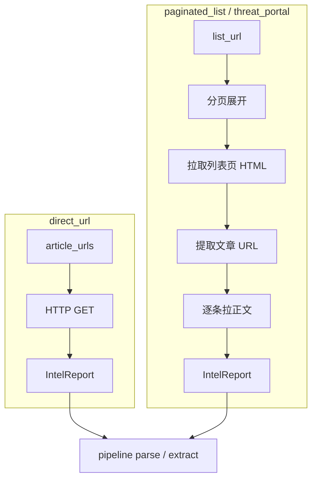

# 采集与解析 — 业务场景设计

> 与 [system-config.md](./system-config.md)、[design.md](./design.md) 对齐。  
> 统一入口：`CollectSource` → `ingest.RunCollectSource` → `IntelReport` → `pipeline`（parse → extract）→ `AttackKnowledge`。

---

## 1. 三类场景映射

| 用户场景 | 类型代码 | 调度 | 列表发现 | 分页 | 详情拉取 | 解析 |
|----------|----------|------|----------|------|----------|------|
| **A. 单 URL 直采** | `direct_url` | 可选 cron | 无 | 无 | 配置内 1..N 个文章 URL | `parser_profile` / 默认 HTML |
| **B. 列表定时监测 + 路径分页** | `paginated_list` | cron | `list_url` + 路径翻页 | `/page/2/` 等 | 从列表抽文章链 | 同上 |
| **C. 威胁源门户 + 列表抽链 + 分页** | `threat_portal` | cron | 门户/标签列表页 | 路径分页 或 **滚动加载** | 逐条 GET 文章 | 同上 |



**与旧类型关系：**

| 旧 `type` | 新建议 |
|-----------|--------|
| `scheduled_url` | 合并为 `paginated_list`（`pagination.type=none` 即单列表页） |
| `wechat_feed` | 仍为 `wechat_feed` 或 `threat_portal` + `render_mode=playwright` |
| `rss` | 保留；无列表 HTML，走 feed 解析 |

---

## 2. 场景 A：`direct_url`（单 URL 直采）

**适用：** 已知文章详情页、厂商单篇通告 URL、手工维护的固定链接。

**流程：**

1. 调度触发（或「立即运行」）
2. 对 `config.article_urls[]` 依次 GET
3. 去重（`source_url`）→ 写入 `intel_report` → `ProcessImport` → `parse` → `extract`

**config 示例：**

```json
{
  "article_urls": [
    "https://blog.netlab.360.com/example-article/"
  ],
  "timeout_sec": 30,
  "title_from": "html"
}
```

**解析：** 走全局 `parser_profile_id`；标题默认从 `<title>` 或首个 `<h1>` 提取（`pipeline.HTMLToText` 前由 ingest 补全）。

---

## 3. 场景 B：`paginated_list`（列表监测 + 路径分页）

**适用：** WordPress / 静态站点标签页，如：

- `https://blog.netlab.360.com/tag/botnet/`
- `https://blog.netlab.360.com/tag/botnet/page/2/`

**流程：**

1. 展开分页 URL 集合（见 §4）
2. 对每个列表页 GET，提取文章链接（`link_extract`）
3. 合并去重，限制 `max_items_per_run`
4. 对每条新文章 URL GET 正文 → 入库流水线

**config 示例（Ghost 类站点：标签列表 + `/page/N/` 分页，以 Netlab botnet 为例）：**

```json
{
  "list_url": "https://blog.netlab.360.com/tag/botnet/",
  "pagination": {
    "type": "path",
    "path_template": "https://blog.netlab.360.com/tag/botnet/page/{page}/",
    "start_page": 2,
    "max_pages": 5,
    "stop_on_empty_list": true
  },
  "link_extract": {
    "must_contain": "blog.netlab.360.com",
    "exclude_contains": ["/tag/", "/page/", "/feed", "#"],
    "prefer_path_regex": "/20[0-9]{2}/"
  },
  "article_base": "https://blog.netlab.360.com",
  "max_items_per_run": 15,
  "timeout_sec": 30,
  "delay_ms": 500
}
```

**定时：** `schedule_cron` 如 `0 */6 * * *`；每次运行只导入**新 URL**（库内 `source_url` 去重）。

---

## 4. 场景 C：`threat_portal`（威胁数据源门户）

与 B 共用 **列表发现 + 文章爬取** 管道，差异在入口与分页方式。

| 子模式 | `pagination.type` | 说明 |
|--------|-------------------|------|
| 路径分页 | `path` | 与 B 相同，优先实现 |
| 滚动分页 | `scroll` | 列表项由 JS 懒加载，需 **Playwright**（P2b） |
| 无分页单页 | `none` | 仅 `list_url` 一页 |

**滚动分页（规划）：**

```json
{
  "list_url": "https://threat-portal.example/list",
  "pagination": {
    "type": "scroll",
    "scroll_steps": 8,
    "scroll_wait_ms": 1200,
    "render_mode": "playwright"
  },
  "link_extract": {
    "selector": "a.report-link",
    "must_contain": "/report/"
  }
}
```

当前实现：`scroll` 时返回明确错误，提示配置 `path` 或启用 Playwright 服务。

---

## 5. 分页展开规则（`pagination`）

| 字段 | 说明 |
|------|------|
| `type` | `none` \| `path` \| `scroll` |
| `path_template` | 含 `{page}` 占位，如 `.../page/{page}/` |
| `start_page` | 路径分页起始页码，默认 `2`（第 1 页用 `list_url`） |
| `max_pages` | 除首页外最多再抓几页，默认 `5` |
| `stop_on_empty_list` | 某一页提取到 0 条新链接则停止翻页 |

**展开顺序：** `[list_url, page2, page3, ...]` → 逐页提取链接 → 全局去重 → 截断 `max_items_per_run`。

---

## 6. 链接提取（`link_extract`）

| 字段 | 说明 |
|------|------|
| `must_contain` | 绝对 URL 必须包含的子串 |
| `exclude_contains` | 命中则丢弃（分页、标签、锚点） |
| `prefer_path_regex` | 优先保留路径匹配（如年份目录） |
| `selector` | 预留：CSS 选择器（P2，需 goquery） |

标题：优先 `<a>` 文本，否则用 URL 最后一段。

---

## 7. 解析（parse / enrich）分层

| 阶段 | 模块 | 输入 | 输出 |
|------|------|------|------|
| 采集 | `ingest` | 配置 + HTTP | `raw/001.html`、`intel_report` 行 |
| 正文抽取 | `pipeline.parse` | raw HTML | `parsed/v1/body.txt`、摘要 |
| 富化 | `pipeline.extract` | 正文 + `ModelProvider` | CVE/TTP、写知识库 |

`parser_profile_id` 挂在 `CollectSource` 上；未配置则用内置 `HTMLToText`。

---

## 8. 执行与可观测

- **手动：** WebUI「立即运行」→ `POST .../collect-sources/{id}/run`
- **定时：** `ingest.Scheduler` + `schedule_cron`（间隔见 `AMI_INGEST_MIN_GAP_SEC`）
- **记录：** `collect_source.last_run_at` / `last_status` / `last_error`
- **规划：** `collect_job` / `collect_job_item` 表记录每页、每 URL 成败（P2）

---

## 9. 实现状态（代码）

| 能力 | 状态 |
|------|------|
| `direct_url` | 已实现 |
| `paginated_list` + `path` 分页 | 已实现 |
| `threat_portal` | 已实现（同 paginated；`scroll` 返回提示） |
| `scheduled_url` / `wechat_feed` | 兼容旧配置 |
| Playwright 滚动分页 | 未实现（文档已定义） |

---

## 10. WebUI 配置指引

新建采集源时按场景选择类型，表单会切换：

- **直采 URL**：填写一个或多个文章地址
- **分页列表**：列表入口 + 路径模板 + 链接过滤
- **威胁门户**：与分页列表相同，另可标注是否需滚动（只读提示）

保存后使用「运行」验证，在 **采集队列**（`/intel`）查看流水线状态。
