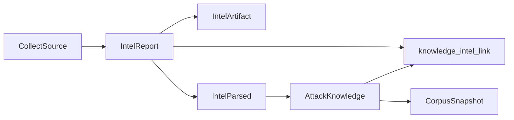

# 存储与物证规范

> 配合 [design.md](./design.md) §4、[data-model.md](./data-model.md)。**列表/查询只读 SQLite**；文件系统仅供 Worker 与按需原文 API。

---

## 1. 环境变量

| 变量 | 默认 | 说明 |
|------|------|------|
| `AMI_DATA_DIR` | `./data` | 根目录：含 `ami.db` 与 `store/` |

备份：复制整个 `AMI_DATA_DIR` 即可。

---

## 2. 目录布局

```
${AMI_DATA_DIR}/
  ami.db
  store/
    intel/{intel_id}/
      manifest.json
      raw/
        001.html
        002.png
      parsed/
        v1/
          body.md
          body.txt
          meta.json
          chunks.jsonl
          figures/
            fig-001.svg
    corpus/
      knowledge/{knowledge_id}/
        snapshot-20260530120000.jsonl
  analytics/
    ami.duckdb          # optional
```

---

## 3. 三层数据平面

| 层 | 内容 | 介质 | 键 |
|----|------|------|-----|
| **L0 Raw** | 采集原文、附件、响应元数据 | 文件 | `intel_id` + `artifact_seq` |
| **L1 Parsed** | 清洗正文、分块、图示 | 文件 + SQLite `intel_parsed` | `intel_id` + `parse_version` |
| **L2 Curated** | 攻击知识、训练语料快照 | SQLite + JSONL | `knowledge_id` |

SQLite 存路径与哈希，**大文件不进 BLOB**（仅 ≤4KB snippet 可内联）。

---

## 4. manifest.json 示例

```json
{
  "intel_id": "ir-20260530-001",
  "source_url": "https://example.com/report",
  "fetched_at": "2026-05-30T12:00:00Z",
  "artifacts": [
    {
      "seq": 1,
      "role": "html",
      "filename": "001.html",
      "mime": "text/html",
      "sha256": "abc...",
      "size_bytes": 120400
    }
  ]
}
```

表 `intel_artifact` 与 manifest 一致；Worker 写入后更新 `intel_report.has_raw = true`。

---

## 5. 血缘链



---

## 6. 谁读文件系统

| 角色 | 读 Raw | 读 Parsed |
|------|--------|-----------|
| 列表/搜索 API | 否 | 否 |
| 详情 API（默认） | 否 | 否 |
| `GET /intel/:id/original` | 是 | 可选 body.md |
| Pipeline Worker | 是 | 写 |
| 语料导出 Worker | 否 | 是（已发布知识关联 intel） |

---

## 7. Parse 回写 DB（列表不必读文件）

Worker 在 Parse 完成时更新 `intel_report`：

- `summary_snippet`（列表摘要）
- `body_preview`（可选，≤2048 字符）
- `has_parsed = true`
- `intel_parsed` 行：`body_md_path`, `body_txt_path`, `chunk_path`, `parser_profile_id`

---

## 8. 训练语料（L2）

**触发：** `AttackKnowledge.status` → `published`（或再发布后）。

**路径：** `store/corpus/knowledge/{knowledge_id}/snapshot-{ts}.jsonl`

**单条 JSONL 字段（建议）：**

- `knowledge_id`, `title`, `summary`, `techniques[]`, `target_industries[]`, `procedures[]`
- `evidence[]`: `{ intel_id, artifact_seq, quote_span?, body_md_path }`
- `figures[]`, `schema_version`, `exported_at`

**不含：** `ingest_status=failed` 的报告；`draft` 知识。

表 `knowledge_corpus_export` 记录路径供 UI 导出。

---

## 9. SQLite 维护

| 操作 | 时机 |
|------|------|
| `PRAGMA optimize` | 每日或大批量导入后 |
| FTS 重建 | 批量导入后 `INSERT INTO ...fts` |
| `VACUUM` | 低峰；非常规 |
| 日志归档 | `llm_call_log`、`ingest_run` 按月迁出或 DELETE |

WAL 模式；连接级 PRAGMA 见 [design.md](./design.md) §4.2。

---

## 10. 可选 DuckDB

从 SQLite 增量同步维度宽表到 `analytics/ami.duckdb`，专供 `GET /analytics/*` 重聚合，避免在线 SQLite 大 `GROUP BY`。

---

## 11. 相关文档

- [api-overview.md](./api-overview.md) — 原文/物证端点
- [system-config.md](./system-config.md) — Parser/Enrich 输出约定
