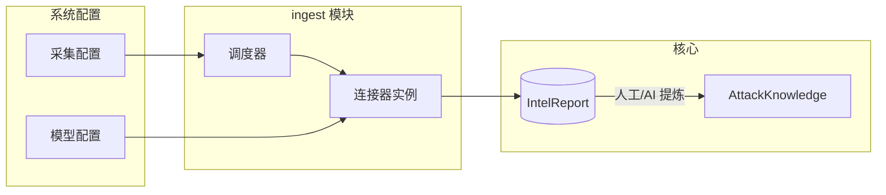
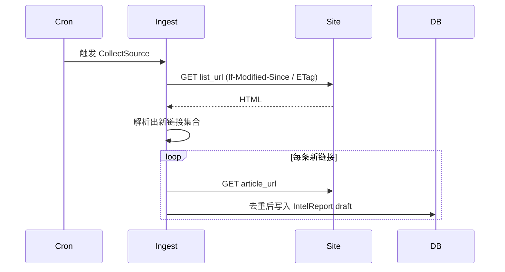
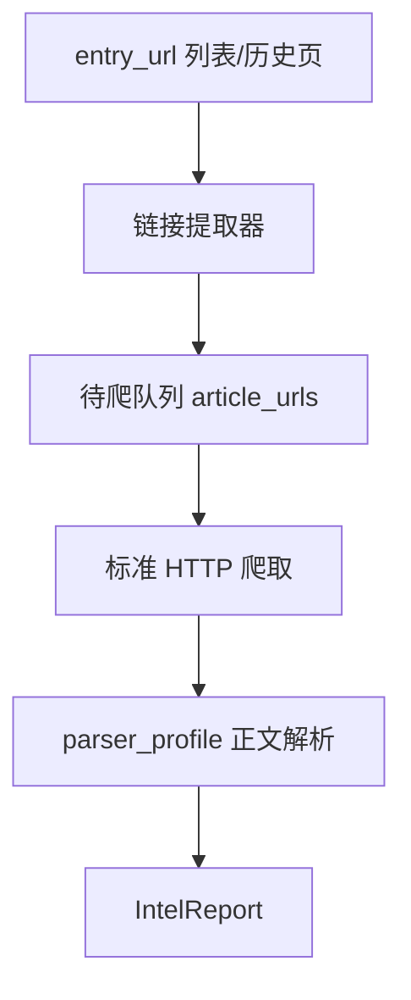

# 系统配置 — 设计说明

> 面向 **service 采集模块（ingest）** 与 **解析/富化（parse / enrich）** 的运行时配置。  
> 配置入口挂在 **威胁情报库** 下，与「实体维度浏览」并列，属于 **平台运营/数据接入** 能力，不参与威胁实体聚合统计。

---

## 1. 定位与边界

| 项 | 说明 |
|----|------|
| **消费者** | `service` 中 ingest worker、cron 调度器、可选 enrich worker |
| **产出物** | 写入 **情报工作台**（`IntelReport`，`ingest_status` 流转），**不直接**写攻击知识库 |
| **不做** | 多租户配置隔离、连接器市场、OpenCTI 式 STIX 流式总线 |
| **与情报工作台** | 采集配置定义「从哪来、多久采一次」；工作台定义「采回来怎么审、挂哪条知识」 |



---

## 2. 导航与页面结构（WebUI）

侧栏 **底部并列** 两个一级分组：

| 一级分组 | 子菜单 | 路由 |
|----------|--------|------|
| **威胁情报库** | CVE、恶意软件、组织… | `/analytics/:dimension` |
| **系统配置** | 采集配置 | `/settings/collect` |
| | 解析模板 | `/settings/parser` |
| | 模型服务 | `/settings/provider` |

页面布局对齐 **攻击知识库** 查询区：顶部 `FilterCard` +「查询」；列表 + 分页；新建/编辑用抽屉或二级页。

---

## 3. 配置模块一：采集配置

### 3.1 配置对象：`CollectSource`（采集源）

一条采集源 = 一个可调度、可启停的连接器实例。

| 字段 | 类型 | 说明 |
|------|------|------|
| `id` | uuid | 主键 |
| `name` | string | 显示名，如「360 Netlab 博客」 |
| `type` | enum | 见 §3.2 |
| `enabled` | bool | 是否参与调度 |
| `schedule_cron` | string | cron 表达式；`manual` 类型可为空 |
| `priority` | int | 队列优先级，默认 0 |
| `source_label` | string | 写入 `IntelReport.source_name` |
| `config` | jsonb | 类型相关参数（见各场景） |
| `parser_profile_id` | uuid? | 关联解析配置（HTML/微信正文） |
| `dedup_policy` | enum | `url` / `content_hash` / `title_date` |
| `last_run_at` | datetime? | 上次执行 |
| `last_status` | enum | `success` / `partial` / `failed` / `skipped` |
| `last_error` | text? | 失败摘要 |
| `created_at` / `updated_at` | datetime | 审计 |

### 3.2 采集场景（类型枚举）

在已给出的两类基础上，结合 [design.md](./design.md) §7 轻量连接器，建议 **首期内置** 与 **后续扩展** 如下。

| 类型 | 代码 | 场景说明 | 典型配置项 | 阶段 |
|------|------|----------|------------|------|
| **定时 URL 监测** | `scheduled_url` | 固定 URL 列表/门户页，按 cron 拉取 **最新** 内容（列表页 diff 或详情直链） | `urls[]`、`list_selector`、`link_selector`、`max_items_per_run`、HTTP 头、超时 | **P1**（已提供） |
| **微信链接采集** | `wechat_feed` | 从 **公众号聚合页/历史消息页** 提取文章链接，再逐条爬取正文 | `entry_url`、`link_extract_rule`（CSS/XPath/正则）、`article_parser_profile`、`cookie_ref`（密钥引用）、限速 | **P1**（已提供） |
| **RSS / Atom** | `rss` | 安全博客、厂商公告订阅 | `feed_url`、`etag_support` | **P1** |
| **手工上传入口** | `manual_upload` | 分析师 PDF/HTML/EML 上传（配置侧仅开关与大小限制） | `max_file_mb`、`allowed_mime[]` | **P1** |
| **Webhook 推送** | `webhook` | 外部 SOAR/脚本 POST 归一化 JSON | `secret_token`、`payload_schema` | **P2** |
| **STIX/文件包** | `stix_bundle` | 定时拉取或上传 STIX 2.1 子集 | `path_or_url`、`mapping_profile` | **P2** |
| **邮箱/IMAP** | `email_imap` | 威胁订阅邮件、厂商通报 | `imap_host`、`folder`、`filter_rules` | **P3** |
| **API 拉取** | `api_pull` | 带 Token 的 REST 分页（如 CERT JSON API） | `base_url`、`auth_ref`、`pagination` | **P2** |

**原则：** 首期只做 **Pull + 上传**；Push/Webhook 用同一 ingest 队列接入即可。

### 3.3 场景详细设计

#### 3.3.1 定时 URL 监测（`scheduled_url`）

**适用：** 安全博客更新页、威胁通告列表、固定「最新文章」入口。

**流程：**



**`config` 示例：**

```json
{
  "list_url": "https://blog.example.com/threat/",
  "link_selector": "article.card a[href]",
  "article_base": "https://blog.example.com",
  "headers": { "User-Agent": "AMI-Ingest/1.0" },
  "timeout_sec": 30,
  "respect_robots": true
}
```

**去重：** 默认 `url`；列表页仅发现新 URL 时拉详情。

#### 3.3.2 微信采集（`wechat_feed`）

**适用：** 公众号历史消息页、第三方微信文章聚合 URL（合规与账号授权由运维自行保证）。

**两阶段管道（与「单 URL 直采」区分）：**



| 阶段 | 职责 | 失败处理 |
|------|------|----------|
| **提取** | 从入口页拿到文章 URL 列表（可能需 JS 渲染则标记 `render_mode: playwright`） | 记录 `last_error`，不删已有任务 |
| **爬取** | 对每条 URL 拉 HTML，限速 `delay_ms` | 单条失败记入 `ingest_job_item`，不阻塞整批 |

**`config` 示例：**

```json
{
  "entry_url": "https://...",
  "link_extract": {
    "mode": "css",
    "selector": ".msg_list a",
    "url_normalize": "absolute"
  },
  "crawl": {
    "delay_ms": 2000,
    "max_articles_per_run": 20,
    "cookie_secret_ref": "vault:wechat_session"
  },
  "parser_profile_id": "wechat_article_html_v1"
}
```

**注意：** Cookie/Token 仅存 **密钥引用**，不落库明文；配置页仅显示「已配置/未配置」。

#### 3.3.3 RSS（`rss`）— 建议补充

与 `scheduled_url` 类似，但用标准 feed 解析，减少列表页规则维护成本。

#### 3.3.4 手工上传（`manual_upload`）— 建议补充

配置页控制：单文件大小、允许类型；实际上传走 `POST /api/v1/intel/import`，与采集源解耦，但在「采集配置」中保留 **开关** 便于运营统一查看。

#### 3.3.5 Webhook / API / STIX — 后续

统一进入 **ingest 归一化层**：

```json
{
  "title": "...",
  "source_url": "...",
  "disclosed_at": "...",
  "html": "...",
  "external_id": "..."
}
```

### 3.4 调度与执行

| 概念 | 说明 |
|------|------|
| `CollectJob` | 一次调度运行记录（开始/结束、抓取数、失败数） |
| `CollectJobItem` | 单 URL/单条 feed entry 的处理结果 |
| 队列 | 单进程 worker + DB 队列即可（轻量）；cron 只负责 **触发**，不阻塞 HTTP API |
| 并发 | 每源 `max_concurrency` 默认 1；微信爬取建议串行+延时 |

### 3.5 采集配置 UI（字段级）

**列表列：** 名称、类型、调度、启用、上次运行、状态、操作（编辑/立即运行/日志）。

**编辑表单分区：**

1. 基本信息（名称、来源标签、启用）
2. 调度（cron 预设：每小时/每日 + 自定义）
3. 类型参数（动态表单，按 `type` 切换）
4. 解析与去重（parser_profile、dedup_policy）
5. 高级（超时、请求头、密钥引用）

---

## 4. 配置模块二：模型配置

供 **parse / enrich** 使用，与采集解耦，可被多个 `CollectSource` 引用。

### 4.1 配置对象

| 对象 | 用途 |
|------|------|
| `ModelProvider` | LLM/Embedding 服务商：OpenAI 兼容、本地 Ollama、企业网关 |
| `ParserProfile` | 正文抽取规则：通用 HTML、微信排版、PDF 文本层 |
| `EnrichProfile` | 富化任务：IOC 抽取、TTP 候选、摘要（**输出进待审，不自动发布知识**） |

### 4.2 `ModelProvider` 字段（摘要）

| 字段 | 说明 |
|------|------|
| `name` | 如「内部 Qwen」 |
| `kind` | `llm` / `embedding` |
| `base_url` | API 根地址 |
| `model_id` | 模型名 |
| `api_key_ref` | 密钥引用 |
| `default_for` | `parse` / `enrich` / `embedding` |
| `enabled` | 是否可用 |

### 4.3 `ParserProfile` 字段（摘要）

| 字段 | 说明 |
|------|------|
| `name` | 如 `wechat_article_html_v1` |
| `content_selector` | 正文 CSS |
| `strip_selectors` | 广告/分享块 |
| `title_selector` | 标题 |
| `date_selector` | 披露时间 |
| `post_process` | 可选 LLM 清洗（引用 `ModelProvider`） |

### 4.4 `EnrichProfile` 字段（摘要）

| 字段 | 说明 |
|------|------|
| `ioc_extract` | 是否启用规则/模型 IOC 抽取 |
| `ttp_suggest` | 是否推荐 MITRE（需矩阵上下文） |
| `summary_llm` | 是否生成摘要 |
| `confidence_threshold` | 自动写入草稿的最低置信（仍须人工发布） |

**边界：** 模型配置 **不** 自动创建 `AttackKnowledge`；只加速情报工作台审核。

### 4.5 模型配置 UI

Tab：**模型服务** | **解析模板** | **富化策略**  
列表 + 编辑；密钥仅显示掩码与「更换」。

---

## 5. 与现有模块关系

| 模块 | 关系 |
|------|------|
| 情报工作台 | 采集产物 `ingest_status = draft/parsing/pending_review` |
| 攻击知识库 | 人工审核后挂载；模型仅推荐 |
| 威胁情报库维度页 | 无直接配置；统计来自已发布知识 |
| 运营总览 | 可展示「采集源数」「近 24h 采集量」（读 `CollectJob` 聚合） |

---

## 6. API 草案（`service/`）

| 方法 | 路径 | 说明 |
|------|------|------|
| GET/POST | `/api/v1/settings/collect-sources` | 采集源 CRUD |
| POST | `/api/v1/settings/collect-sources/:id/run` | 立即执行 |
| GET | `/api/v1/settings/collect-jobs` | 运行日志 |
| GET/POST | `/api/v1/settings/model-providers` | 模型服务 |
| GET/POST | `/api/v1/settings/parser-profiles` | 解析模板 |
| GET/POST | `/api/v1/settings/enrich-profiles` | 富化策略 |

权限：仅 **管理员** 可写；分析师只读（可选）。

---

## 7. 分期建议

| 阶段 | 采集 | 模型 |
|------|------|------|
| **P1 Demo** | UI + Mock；实现 `scheduled_url`、`wechat_feed`、`rss` 配置结构 | UI + Mock；1 个 LLM Provider + 1 个 ParserProfile |
| **P2** | Worker 真调度 + `CollectJob` 日志；Webhook | enrich 摘要/IOC 建议 |
| **P3** | IMAP、STIX、API pull | Embedding / RAG 索引配置 |

---

## 8. 安全与合规

- 采集源 URL、Cookie、API Key：**密钥库引用**，配置表不存明文。  
- 微信等第三方入口：需运维确认 **授权与 robots/服务条款**。  
- 审计：配置变更记 `audit_log`（谁、何时、改了什么）。  
- 限速与 `max_articles_per_run`，避免对信源造成压力。

---

## 9. 待确认项（产品）

1. 微信入口是否仅支持 **固定历史页 URL**，还是需要对接官方/第三方 API？  
2. 采集失败告警：站内通知 / 邮件 / 仅日志？  
3. 同一 `source_url` 重复采集：覆盖草稿还是跳过？（建议：**已发布跳过，草稿可覆盖**）
